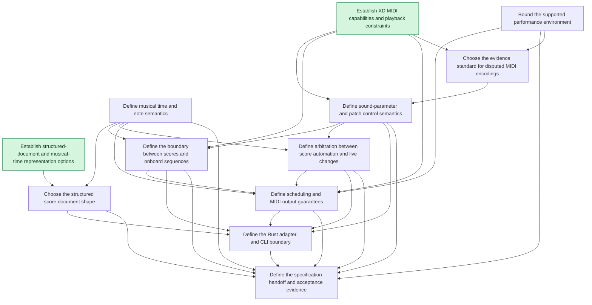

# Decision dependencies

Charting snapshot. Arrows run from prerequisites to the decisions they unblock. Research is complete; human decisions remain open. Use the [tracker query](README.md#query-the-frontier) for current availability after later sessions.

## Available after charting

- [Define musical time and note semantics](issues/xd-dsl-0005-musical-semantics.md)
- [Bound the supported performance environment](issues/xd-dsl-0006-performance-environment.md)
